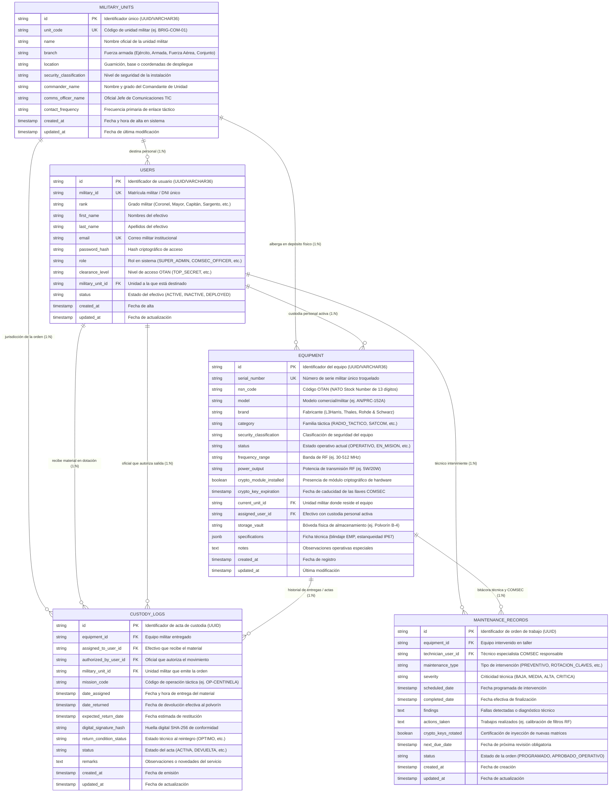

# SIGIN-MIL: Sistema de Gestión e Inventario TIC y Comunicaciones Militares

> **Plataforma Integral de Mando y Control para Material de Informática, Radiocomunicaciones Tácticas, Cifrado COMSEC y Equipamiento C4ISR**  
> Desarrollado con **Node.js**, **Express**, **PostgreSQL / MySQL**, **Sequelize ORM**, **React 19**, **TypeScript**, **Tailwind CSS** y **Docker Compose**.  
> **100% Autónomo: Cero dependencias externas o CDNs (Diseñado para redes tácticas militares aisladas / Air-Gapped).**

---

## Índice de Contenidos

1. [Visión General del Sistema](#1-visión-general-del-sistema)
2. [Arquitectura del Backend (Modular y Multicapa)](#2-arquitectura-del-backend-modular-y-multicapa)
   - [Estructura de Carpetas del Proyecto](#estructura-de-carpetas-del-proyecto)
   - [Desglose de Capas del Backend](#desglose-de-capas-del-backend)
   - [Flujo de Procesamiento de una Petición](#flujo-de-procesamiento-de-una-petición)
3. [Esquema de Base de Datos Relacional (PostgreSQL)](#3-esquema-de-base-de-datos-relacional-postgresql)
   - [Diagrama Entidad-Relación (Mermaid)](#diagrama-entidad-relación-erd)
   - [Explicación Detallada de Tablas y Atributos](#explicación-detallada-de-tablas-y-atributos)
   - [Relaciones, Claves Foráneas e Integridad Referencial](#relaciones-claves-foráneas-e-integridad-referencial)
   - [Índices Tácticos de Alto Rendimiento](#índices-tácticos-de-alto-rendimiento)
4. [Instrucciones de Configuración y Despliegue Local](#4-instrucciones-de-configuración-y-despliegue-local)
   - [Requisitos Previos del Sistema](#requisitos-previos-del-sistema)
   - [Paso 1: Instalación de Dependencias](#paso-1-instalación-de-dependencias)
   - [Paso 2: Configuración del Archivo `.env`](#paso-2-configuración-del-archivo-env)
   - [Paso 3 (Opción A): Ejecución con Docker Compose (Recomendado)](#paso-3-opción-a-ejecución-con-docker-compose-recomendado)
   - [Paso 3 (Opción B): Ejecución Local Nativa (Node.js + PostgreSQL)](#paso-3-opción-b-ejecución-local-nativa-nodejs--postgresql)
   - [Verificación de Salud del Sistema (Healthcheck)](#verificación-de-salud-del-sistema-healthcheck)
5. [Guía de Uso Básico y Operaciones del Sistema](#5-guía-de-uso-básico-y-operaciones-del-sistema)
   - [Tablero de Mando C4ISR (Dashboard)](#1-tablero-de-mando-c4isr-dashboard)
   - [Inventario Táctico Militar (Catálogo TIC)](#2-inventario-táctico-militar-catálogo-tic)
   - [Gestor de Custodia y Actas Digitales](#3-gestor-de-custodia-y-actas-digitales)
   - [Taller Técnico & Auditoría COMSEC](#4-taller-técnico--auditoría-comsec)
   - [Visor de Arquitectura Backend](#5-visor-de-arquitectura-backend)
   - [Generador y Descarga en Archivo .ZIP](#6-generador-y-descarga-en-archivo-zip)
6. [Referencia Completa de la API RESTful](#6-referencia-completa-de-la-api-restful)
7. [Normas Militares y Seguridad Operacional](#7-normas-militares-y-seguridad-operacional)

---

## 1. Visión General del Sistema

El **SIGIN-MIL** es una plataforma de software de grado militar creada para resolver la necesidad crítica de inventariado, custodia estricta, trazabilidad histórica y mantenimiento preventivo/correctivo del parque tecnológico y de comunicaciones de las Fuerzas Armadas y organismos de defensa.

### Familias de Equipamiento Soportadas:
1. **Radiocomunicaciones Tácticas**: Transceptores portátiles (Manpack, Handheld) y vehiculares HF/VHF/UHF (L3Harris Falcon III AN/PRC-152A, AN/PRC-117G, Thales TRC-9210 PR4G F@stnet).
2. **Terminales Satelitales (SATCOM)**: Terminales tácticos *Flyaway* y *Manpack* para bandas militar X, Ka militar y enlaces DAMA.
3. **Equipos Criptográficos y COMSEC**: Encriptadores de red IP tipo TACLANE KG-175D (certificados NSA Tipo 1) y cargadores de llaves SKL / CYZ-10.
4. **Servidores e Informática Rugerizada**: Servidores de campaña certificados bajo normas **MIL-STD-810H** (impacto, vibración, polvo, humedad) y **MIL-STD-461** (compatibilidad electromagnética y blindaje contra pulso EMP).
5. **Nodos y Redes de Campaña**: Conmutadores y routers de fibra óptica táctica estancos (clasificación IP67) para puestos de mando móvil.
6. **Sistemas C4ISR & Drones**: Estaciones de control en tierra (GCS) para vehículos aéreos no tripulados (UAV) tácticos y enlaces de datos ISR.
7. **Guerra Electrónica & Escaneo Espectral**: Receptores de vigilancia del espectro electromagnético y radiogoniometría táctica.

---

## 2. Arquitectura del Backend (Modular y Multicapa)

El backend de SIGIN-MIL sigue una **arquitectura en capas modular orientada a dominio (DDD/MVC)** implementada en **Node.js**, **Express** y **TypeScript**, desacoplando totalmente la capa de acceso a datos (Sequelize ORM), la lógica de negocio militar (Controladores), la exposición de endpoints (Rutas REST) y las políticas de seguridad (Middlewares).

### Estructura de Carpetas del Proyecto

```text
sigin-mil-inventory/
├── .env                          # Variables de entorno activas (localhost / Docker)
├── .env.example                  # Plantilla documentada de variables de configuración
├── .dockerignore                 # Filtros de exclusión para imágenes Docker
├── docker-compose.yml            # Orquestación de PostgreSQL 16, Backend API y Frontend
├── Dockerfile                    # Construcción ligera multi-stage basada en Alpine Linux
├── package.json                  # Dependencias, scripts de desarrollo y comandos Docker
├── tsconfig.json                 # Configuración de compilación TypeScript estricta
├── vite.config.ts                # Configuración de empaquetado Vite + Tailwind CSS
├── metadata.json                 # Metadatos del aplicativo e indicadores de plataforma
├── README.md                     # Manual técnico y exhaustivo de la plataforma
│
├── backend/                      # CAPA DE SERVIDOR Y LÓGICA DE NEGOCIO
│   └── src/
│       ├── app.ts                # Inicialización de Express, CORS y middlewares globales
│       ├── server.ts             # Punto de entrada HTTP y arranque del listener (Puerto 5000)
│       │
│       ├── config/               # CONFIGURACIÓN Y BASES DE DATOS
│       │   ├── database.ts       # Configuración agnóstica de Sequelize (PostgreSQL / MySQL)
│       │   └── init-db.sql       # Script DDL SQL puro para inicialización y migraciones directas
│       │
│       ├── models/               # MODELOS RELACIONALES DEL ORM
│       │   ├── MilitaryUnit.ts   # Destacamentos, regimientos, brigadas y bases
│       │   ├── User.ts           # Efectivos militares, rangos, roles y credencial de clearance
│       │   ├── Equipment.ts      # Hardware táctico, número de serie militar y código OTAN NSN
│       │   ├── CustodyLog.ts     # Actas de entrega/recepción y firmas criptográficas SHA-256
│       │   ├── MaintenanceRecord.ts # Órdenes de calibración RF y rotación de claves COMSEC
│       │   └── index.ts          # Registro central de asociaciones e integridad referencial
│       │
│       ├── controllers/          # CONTROLADORES Y LÓGICA DE NEGOCIO
│       │   ├── equipmentController.ts    # CRUD de equipos, estadísticas y cálculo de alertas COMSEC
│       │   ├── custodyController.ts      # Rubricado de actas de custodia y descargo a depósito
│       │   ├── maintenanceController.ts  # Programación y certificación de mantenimiento técnico
│       │   ├── militaryUnitController.ts # Gestión de destacamentos y dependencias orgánicas
│       │   └── authController.ts         # Autenticación militar y verificación de pases
│       │
│       ├── routes/               # ENRUTADORES REST MODULARES
│       │   ├── equipmentRoutes.ts    # Endpoints para /api/v1/equipment
│       │   ├── custodyRoutes.ts      # Endpoints para /api/v1/custody
│       │   ├── maintenanceRoutes.ts  # Endpoints para /api/v1/maintenance
│       │   ├── militaryUnitRoutes.ts # Endpoints para /api/v1/military-units
│       │   ├── authRoutes.ts         # Endpoints para /api/v1/auth
│       │   └── index.ts              # Agrupador central de rutas bajo /api/v1
│       │
│       ├── middlewares/          # POLÍTICAS DE SEGURIDAD Y CONTROL
│       │   ├── authMiddleware.ts # Control de acceso RBAC y validación de Clearance de seguridad
│       │   └── errorHandler.ts   # Manejador centralizado de excepciones y respuestas HTTP
│       │
│       └── seeders/              # SEMILLAS DE DATOS INICIALES
│           └── militarySeeds.ts  # Población inicial con datos militares hiperrealistas
│
└── src/                          # CAPA DE PRESENTACIÓN (FRONTEND REACT + TS + TAILWIND)
    ├── main.tsx                  # Punto de arranque del cliente React
    ├── App.tsx                   # Panel maestro táctico C4ISR y orquestador de vistas
    ├── index.css                 # Estilos globales compilados con Tailwind CSS v4
    ├── types/                    # Interfaces y contratos de tipos TypeScript
    │   └── military.ts           # Tipos de equipamiento, actas, unidades y clasificaciones
    ├── services/                 # Servicios de datos tácticos locales y remotos
    │   └── militaryData.ts       # Gestor unificado con persistencia y fallback táctico
    └── components/               # MÓDULOS DE INTERFAZ DE USUARIO
        ├── DashboardOverview.tsx # Tablero C4ISR, métricas de operatividad y alertas COMSEC
        ├── EquipmentInventory.tsx# Catálogo con búsqueda por NSN, filtros y alta de material
        ├── CustodyManager.tsx    # Asignación de custodia y verificación de firmas SHA-256
        ├── MaintenanceCOMSEC.tsx # Gestión de calibraciones RF y rotación de matrices cripto
        ├── BackendArchitecture.tsx # Visor interactivo de ERD, endpoints y árbol de código
        └── ZipExporter.tsx       # Empaquetador y descargador directo del código en archivo .ZIP
```

### Desglose de Capas del Backend

1. **Capa de Configuración (`backend/src/config/`)**:
   - `database.ts`: Conecta con el motor relacional utilizando Sequelize. Es **agnóstico al motor**: con solo alternar la variable `DB_DIALECT` entre `postgres` y `mysql` en el `.env`, el sistema conmuta automáticamente sus dialectos y parámetros de conexión (pooling de conexiones, timeout de socket y logging configurable).
   - `init-db.sql`: Proporciona la definición canónica DDL en SQL puro de las 5 tablas, llaves foráneas, restricciones de unicidad e índices para inicializaciones desatendidas (como el script de entrada en PostgreSQL de Docker).

2. **Capa de Modelos (`backend/src/models/`)**:
   - Cada entidad de negocio militar está modelada mediante una clase e interfaz TypeScript estricta que define tanto los atributos del registro como los tipos de datos en la base de datos.
   - En `index.ts` se centraliza la inyección de asociaciones:
     - Relaciones `hasMany` y `belongsTo` con claves foráneas explícitas.
     - Políticas de integridad referencial: `ON DELETE RESTRICT` para entidades de auditoría (efectivos que poseen material o firman actas) y `ON DELETE CASCADE` para registros subsidiarios.

3. **Capa de Controladores (`backend/src/controllers/`)**:
   - Encapsula las reglas operativas y militares del sistema:
     - **Controlador de Equipamiento**: Realiza agregaciones en tiempo real para el cálculo de tasas de disponibilidad operativa, cuenta de equipos en misión activa y detección de **alarmas COMSEC** (analizando si la fecha de caducidad `crypto_key_expiration` es anterior a los próximos 30 días).
     - **Controlador de Custodia**: Valida que el equipo esté físicamente en depósito (`OPERATIVO`) antes de asignarlo, cambia el estado a `EN_MISION`, genera automáticamente la huella criptográfica SHA-256 del acta digital de entrega y, en el retorno, registra el informe de condición técnica.
     - **Controlador de Mantenimiento**: Administra órdenes técnicas de calibración de RF y ejecuta la rotación de matrices criptográficas, actualizando la fecha de caducidad a un año hacia el futuro para despejar las alertas rojas.

4. **Capa de Rutas (`backend/src/routes/`)**:
   - Proporciona una interfaz RESTful estándar versionada bajo el prefijo `/api/v1`. Cada entidad de negocio posee su propio subenrutador aislado (`equipmentRoutes.ts`, `custodyRoutes.ts`, etc.), garantizando una alta cohesión y bajo acoplamiento.

5. **Capa de Middlewares (`backend/src/middlewares/`)**:
   - `authMiddleware.ts`: Valida pases de guardia y tokens militares. Verifica la jerarquía de **Clearance OTAN** (`UNCLASSIFIED`, `RESTRICTED`, `CONFIDENTIAL`, `SECRET`, `TOP_SECRET`), impidiendo que un usuario con autorización inferior acceda a especificaciones o claves de material de mayor clasificación.
   - `errorHandler.ts`: Atrapa excepciones de validación de base de datos (por ejemplo, duplicados de número de serie o fallos de llave foránea) y devuelve respuestas JSON limpias y estructuradas con códigos HTTP estándar (400, 401, 403, 404, 500).

### Flujo de Procesamiento de una Petición

```text
[ Cliente Táctico / Front ]
           │
           │  HTTP Request (ej. POST /api/v1/custody/assign)
           ▼
[ Middlewares Globales ] ──> CORS Policy + Body Parser JSON
           │
           ▼
[ Router Modular (/api/v1) ] ──> Enrutamiento específico (custodyRoutes)
           │
           ▼
[ Middleware de Seguridad ] ──> Verificación de Rol y Nivel de Clearance
           │
           ▼
[ Controlador de Dominio ] ──> Validación de negocio:
                                1. ¿El equipo está OPERATIVO en depósito?
                                2. Generar huella SHA-256 de firma digital
                                3. Actualizar estado del equipo a EN_MISION
           │
           ▼
[ Capa de Modelos (ORM) ] ──> Transacción SQL relacional hacia PostgreSQL / MySQL
           │
           ▼
[ Respuesta JSON ] <──────── Formato militar estandarizado { success, data, timestamp }
```

---

## 3. Esquema de Base de Datos Relacional (PostgreSQL)

El modelo de datos relacional de SIGIN-MIL ha sido concebido bajo principios de normalización (3FN), garantizando la inmutabilidad de la cadena de custodia y la total auditoría de las telecomunicaciones militares.

### Diagrama Entidad-Relación (ERD)



---

### Explicación Detallada de Tablas y Atributos

#### 1. Tabla `military_units` (Destacamentos y Unidades Orgánicas)
Representa la jerarquía territorial y orgánica de las Fuerzas Armadas (Comandos de Brigada, Batallones de Comunicaciones, Bases Aéreas, Apostaderos Navales).
* **`id`** (`VARCHAR(36) PRIMARY KEY`): Identificador único universal (UUID v4).
* **`unit_code`** (`VARCHAR(50) UNIQUE NOT NULL`): Identificador táctico normalizado (ej. `BRIG-COM-01`, `BAT-TEL-601`).
* **`name`** (`VARCHAR(150) NOT NULL`): Denominación oficial de la unidad (ej. *1ra Brigada de Comunicaciones de Campaña*).
* **`branch`** (`VARCHAR(80) NOT NULL`): Fuerza de pertenencia (`Ejército`, `Armada`, `Fuerza Aérea`, `Comando Conjunto`).
* **`location`** (`VARCHAR(120) NOT NULL`): Emplazamiento geográfico o coordenadas MGRS de la base.
* **`security_classification`** (`VARCHAR(30)`): Nivel de seguridad de la instalación (`CONFIDENTIAL`, `SECRET`, `TOP_SECRET`).
* **`commander_name`** (`VARCHAR(120) NOT NULL`): Nombre y rango del oficial superior a cargo de la guarnición.
* **`comms_officer_name`** (`VARCHAR(120)`): Oficial especialista responsable del parque TIC.
* **`contact_frequency`** (`VARCHAR(50)`): Frecuencia fija para enlaces de mando y control (HF/VHF).

#### 2. Tabla `users` (Personal Militar y Operadores del Sistema)
Almacena al personal de defensa con sus acreditaciones de seguridad, roles operativos y unidad de destino.
* **`id`** (`VARCHAR(36) PRIMARY KEY`): UUID del efectivo militar.
* **`military_id`** (`VARCHAR(50) UNIQUE NOT NULL`): Matrícula militar o documento nacional de identidad militar.
* **`rank`** (`VARCHAR(60) NOT NULL`): Grado militar (ej. *Coronel, Mayor, Capitán, Teniente, Suboficial Mayor, Sargento Primero, Cabo*).
* **`first_name`** / **`last_name`** (`VARCHAR(80) NOT NULL`): Nombres y apellidos del efectivo.
* **`email`** (`VARCHAR(120) UNIQUE NOT NULL`): Correo militar dentro de la red táctica interna.
* **`password_hash`** (`VARCHAR(255) NOT NULL`): Contraseña almacenada con algoritmo de hash seguro (BCrypt/Argon2).
* **`role`** (`VARCHAR(50) NOT NULL`): Perfil de control de acceso:
  - `SUPER_ADMIN`: Control total del sistema, auditoría y configuraciones globales.
  - `COMSEC_OFFICER`: Oficial de Seguridad en Comunicaciones; único habilitado para rotar claves criptográficas.
  - `LOGISTICS_OFFICER`: Oficial de Logística; administra altas, bajas y transferencias entre almacenes.
  - `TECHNICIAN`: Suboficial de Mantenimiento; registra calibraciones de RF y reparaciones.
  - `OPERATOR`: Combatiente u operador táctico; recibe material para cumplimiento de misiones.
* **`clearance_level`** (`VARCHAR(30) NOT NULL`): Nivel de habilitación de seguridad militar OTAN:
  - `UNCLASSIFIED` (Público / Administrativo)
  - `RESTRICTED` (Uso Interno de Guarnición)
  - `CONFIDENTIAL` (Confidencial de Batallón)
  - `SECRET` (Secreto Táctico)
  - `TOP_SECRET` (Máximo Secreto / Material COMSEC Criptográfico)
* **`military_unit_id`** (`VARCHAR(36) REFERENCES military_units(id)`): Unidad militar a la que está destinado.
* **`status`** (`VARCHAR(20)`): Estado operativo del militar (`ACTIVE`, `INACTIVE`, `DEPLOYED`, `ON_LEAVE`).

#### 3. Tabla `equipment` (Hardware Táctico e Informática Militar)
Constituye el núcleo del inventario. Registra cada pieza de equipamiento tecnológico con sus características de radiofrecuencia y blindaje.
* **`id`** (`VARCHAR(36) PRIMARY KEY`): UUID único del equipo.
* **`serial_number`** (`VARCHAR(80) UNIQUE NOT NULL`): Número de serie militar grabado en el chasis del equipo.
* **`nsn_code`** (`VARCHAR(50)`): Código de Catálogo OTAN de 13 dígitos (*NATO Stock Number* - ej. `5820-01-580-2983`).
* **`model`** (`VARCHAR(100) NOT NULL`): Designación técnica del modelo (ej. `AN/PRC-152A Falcon III`).
* **`brand`** (`VARCHAR(80) NOT NULL`): Fabricante homologado (ej. *L3Harris, Thales, Rohde & Schwarz, General Dynamics*).
* **`category`** (`VARCHAR(60) NOT NULL`): Familia de material:
  - `RADIO_TACTICO`: Transceptores HF/VHF/UHF.
  - `SATCOM`: Terminales satelitales fijos y transportables.
  - `CRIPTOGRAFIA_COMSEC`: Encriptadores de datos IP y cargadores de matrices.
  - `SERVIDORES_RUGERIZADOS`: Informática de campaña protegida bajo MIL-STD-810H.
  - `REDES_CAMPANA`: Switches y enrutadores de campaña IP67.
  - `C4ISR_DRONES`: Estaciones de comando de UAV y sensores electro-ópticos.
  - `GUERRA_ELECTRONICA`: Equipos de escucha, jamming e inteligencia de señales (SIGINT).
* **`security_classification`** (`VARCHAR(30) NOT NULL`): Clasificación de seguridad exigida para manipular el equipo.
* **`status`** (`VARCHAR(40) NOT NULL`): Condición actual:
  - `OPERATIVO`: En polvorín listo para ser asignado.
  - `EN_MISION`: Desplegado en el terreno bajo custodia de un efectivo.
  - `EN_MANTENIMIENTO`: En taller para calibración o reparación.
  - `DEPOSITO_RESERVA`: Stock estratégico de reserva.
  - `BAJA_DEFINITIVA`: Equipo destruido, desmilitarizado o desprogramado.
* **`frequency_range`** (`VARCHAR(80)`): Rango de operación en radiofrecuencia (ej. `30 MHz - 512 MHz`).
* **`power_output`** (`VARCHAR(50)`): Potencia radiada de RF (ej. `5W Táctico / 20W Vehicular`).
* **`crypto_module_installed`** (`BOOLEAN DEFAULT FALSE`): Bandera que indica si el chasis aloja un módulo de cifrado hardware (ej. Sierra II, NSA Type 1).
* **`crypto_key_expiration`** (`TIMESTAMP WITH TIME ZONE`): Fecha límite de validez de las matrices de claves criptográficas inyectadas.
* **`current_unit_id`** (`VARCHAR(36) REFERENCES military_units(id)`): Base militar que ostenta la posesión patrimonial.
* **`assigned_user_id`** (`VARCHAR(36) REFERENCES users(id)`): Militar que posee la custodia física en tiempo real.
* **`storage_vault`** (`VARCHAR(80)`): Bóveda de máxima seguridad o armario blindado asignado en el depósito (ej. `Bóveda COMSEC Alfa-3`).
* **`specifications`** (`JSONB`): Atributos extendidos en formato JSON estructurado (ej. estanqueidad al agua, inmunidad a pulsos electromagnéticos EMP, conectores militares Fischer/Amphenol).

#### 4. Tabla `custody_logs` (Cadena de Custodia y Actas Digitales)
Historial inmutable de cada movimiento de entrega y devolución de material. Implementa el principio de no repudio.
* **`id`** (`VARCHAR(36) PRIMARY KEY`): UUID del acta digital.
* **`equipment_id`** (`VARCHAR(36) REFERENCES equipment(id)`): Equipo entregado.
* **`assigned_to_user_id`** (`VARCHAR(36) REFERENCES users(id)`): Efectivo receptor responsable.
* **`authorized_by_user_id`** (`VARCHAR(36) REFERENCES users(id)`): Oficial o Jefe de Depósito que autoriza la salida.
* **`military_unit_id`** (`VARCHAR(36) REFERENCES military_units(id)`): Unidad orgánica donde se formaliza el acta.
* **`mission_code`** (`VARCHAR(80)`): Código de misión u operación de despliegue (ej. `OPERACION_ESCUDO_NORTE_2026`).
* **`date_assigned`** (`TIMESTAMP WITH TIME ZONE DEFAULT CURRENT_TIMESTAMP`): Momento exacto de la entrega.
* **`date_returned`** (`TIMESTAMP WITH TIME ZONE`): Momento exacto de reingreso al almacén.
* **`expected_return_date`** (`TIMESTAMP WITH TIME ZONE`): Fecha límite en que el material debe ser reintegrado.
* **`digital_signature_hash`** (`VARCHAR(255)`): **Hash SHA-256 de conformidad militar**. Integra en un hash criptográfico el ID del equipo, número de serie, matrícula del militar receptor, matrícula del autorizador y timestamp.
* **`return_condition_status`** (`VARCHAR(50)`): Evaluación del estado al ser reintegrado (`OPTIMO`, `DESGASTE_NORMAL`, `CON_FALLA`, `DAÑADO`).
* **`status`** (`VARCHAR(30) DEFAULT 'ACTIVA'`): Estado del movimiento (`ACTIVA`, `DEVUELTA`, `EXTRAVIADO`, `EN_INVESTIGACION`).
* **`remarks`** (`TEXT`): Notas sobre el uso en el terreno o novedades técnicas reportadas por el operador.

#### 5. Tabla `maintenance_records` (Mantenimiento Técnico y Ciclo COMSEC)
Bitácora de intervenciones electrónicas y control de claves criptográficas.
* **`id`** (`VARCHAR(36) PRIMARY KEY`): UUID de la orden técnica.
* **`equipment_id`** (`VARCHAR(36) REFERENCES equipment(id)`): Equipo intervenido.
* **`technician_user_id`** (`VARCHAR(36) REFERENCES users(id)`): Especialista en telecomunicaciones responsable.
* **`maintenance_type`** (`VARCHAR(60)`):
  - `PREVENTIVO`: Limpieza de conectores, pruebas de estanqueidad y potencia RF.
  - `CORRECTIVO`: Reparación de componentes electrónicos, fuentes y antenas.
  - `ROTACION_CLAVES_CRIPTO`: Borrado seguro (*zeroize*) e inyección de nuevas claves TEK/KEK.
  - `CALIBRACION_RF`: Ajuste de filtros pasabanda y calibración del sintetizador de frecuencia.
  - `AUDITORIA_COMSEC`: Verificación de integridad de sellos y auditoría de software criptográfico.
* **`severity`** (`VARCHAR(30)`): Grado de criticidad (`BAJA`, `MEDIA`, `ALTA`, `CRITICA`).
* **`scheduled_date`** / **`completed_date`** (`TIMESTAMP WITH TIME ZONE`): Fechas de programación y cierre de la orden.
* **`findings`** (`TEXT`): Diagnóstico y fallas registradas por el técnico.
* **`actions_taken`** (`TEXT`): Procedimientos ejecutados y piezas reemplazadas.
* **`crypto_keys_rotated`** (`BOOLEAN`): Certificación de que las matrices de cifrado fueron inyectadas con éxito.
* **`next_due_date`** (`TIMESTAMP WITH TIME ZONE`): Fecha límite para la próxima inspección reglamentaria.
* **`status`** (`VARCHAR(40)`): `PROGRAMADO`, `EN_PROCESO`, `APROBADO_OPERATIVO`, `NO_REPARABLE`.

---

### Relaciones, Claves Foráneas e Integridad Referencial

La base de datos impone reglas estrictas de integridad referencial para evitar inconsistencias que comprometan la seguridad de la información:

1. **`equipment.current_unit_id` -> `military_units.id` (`ON DELETE SET NULL`)**: Si una unidad militar es reorganizada o dada de baja, el equipo no se destruye en la base de datos; queda temporalmente sin unidad asignada para reubicación logística.
2. **`equipment.assigned_user_id` -> `users.id` (`ON DELETE SET NULL`)**: Si un efectivo cesa en sus funciones, el equipo se desvincula de su custodia personal.
3. **`custody_logs.assigned_to_user_id` -> `users.id` (`ON DELETE RESTRICT`)**: **Prohibición de eliminación.** Un usuario militar no puede ser borrado de la base de datos si figura como receptor en un acta de custodia histórica. Esto garantiza la trazabilidad forense e impide el borrado de evidencias.
4. **`custody_logs.authorized_by_user_id` -> `users.id` (`ON DELETE RESTRICT`)**: Igual principio de no repudio para los oficiales autorizadores.
5. **`custody_logs.equipment_id` -> `equipment.id` (`ON DELETE CASCADE`)**: Si un equipo es purgado definitivamente tras un proceso de desclasificación formal, sus registros de actas se eliminan en cascada.
6. **`maintenance_records.technician_user_id` -> `users.id` (`ON DELETE RESTRICT`)**: Preserva la firma de los suboficiales técnicos en las órdenes de servicio militar.

---

### Índices Tácticos de Alto Rendimiento

Para garantizar respuestas en milisegundos en escenarios con miles de equipos en despliegue activo, el archivo `init-db.sql` crea los siguientes índices B-Tree:

```sql
CREATE INDEX IF NOT EXISTS idx_equipment_serial ON equipment(serial_number);
CREATE INDEX IF NOT EXISTS idx_equipment_category ON equipment(category);
CREATE INDEX IF NOT EXISTS idx_equipment_classification ON equipment(security_classification);
CREATE INDEX IF NOT EXISTS idx_equipment_status ON equipment(status);
CREATE INDEX IF NOT EXISTS idx_custody_active ON custody_logs(status, assigned_to_user_id);
CREATE INDEX IF NOT EXISTS idx_comsec_crypto_exp ON equipment(crypto_key_expiration);
```
* **`idx_comsec_crypto_exp`**: Permite al motor de base de datos filtrar de forma instantánea los equipos con módulos criptográficos cuyas claves expiran en menos de 30 días, alimentando el monitor de alertas COMSEC del tablero principal.
* **`idx_equipment_serial`**: Acelera la búsqueda de equipos cuando se escanea el número de serie troquelado o código de barras militar en el puesto de guardia.

---

## 4. Instrucciones de Configuración y Despliegue Local

### Requisitos Previos del Sistema
* **Docker Engine 24+** y **Docker Compose v2+** (para despliegue en contenedores).
* **Node.js 20+** y **npm 10+** (para ejecución en desarrollo nativo sin Docker).
* **PostgreSQL 14+** o **MySQL 8.0+** (únicamente si se ejecuta de forma nativa sin Docker).
* **Git** (para control de versiones).

---

### Paso 1: Instalación de Dependencias

Abra una terminal en la raíz del proyecto clonado o extraído y ejecute:

```bash
# Navegar a la carpeta del proyecto
cd sigin-mil-inventory

# Instalar dependencias del frontend y del backend
npm install
```

---

### Paso 2: Configuración del Archivo `.env`

El proyecto incluye un archivo `.env` en la raíz ya preconfigurado para ejecución inmediata en `localhost`. Si no existe, cree una copia de `.env.example`:

```bash
cp .env.example .env
```

#### Detalle de Variables de Configuración:

| Variable | Valor por Defecto | Descripción |
| :--- | :--- | :--- |
| `PORT` | `5000` | Puerto TCP donde escucha la API Express del backend. |
| `NODE_ENV` | `development` | Entorno de ejecución (`development` o `production`). |
| `API_PREFIX` | `/api/v1` | Prefijo global para todos los endpoints REST. |
| `CORS_ORIGIN` | `http://localhost:3000` | Origen autorizado para peticiones CORS desde el frontend React. |
| `DB_DIALECT` | `postgres` | Motor de base de datos ORM (`postgres` o `mysql`). |
| `DB_HOST` | `localhost` | Host del servidor de base de datos (`postgres` dentro de Docker). |
| `DB_PORT` | `5432` | Puerto del motor relacional (`5432` para PostgreSQL, `3306` para MySQL). |
| `DB_NAME` | `mil_inventory_db` | Nombre de la base de datos militar. |
| `DB_USER` | `mil_admin` | Usuario administrador de la base de datos. |
| `DB_PASSWORD` | `SecureMilPass2026!` | Clave de acceso a la base de datos. |
| `DB_LOGGING` | `false` | Activa o desactiva la impresión de sentencias SQL en consola. |
| `JWT_SECRET` | `TACTICAL_MIL_COMSEC...` | Clave simétrica para firma y verificación de tokens de sesión. |
| `JWT_EXPIRES_IN` | `8h` | Duración de la sesión militar antes de requerir reautenticación. |
| `SECURITY_CLASSIFICATION_LEVEL` | `TOP_SECRET` | Nivel de seguridad predeterminado para la terminal de control. |

> **Cambio a MySQL:** Para utilizar MySQL en lugar de PostgreSQL, simplemente cambie `DB_DIALECT=mysql`, `DB_PORT=3306`, descomente el servicio `mysql` en `docker-compose.yml` y ajuste las credenciales correspondientes.

---

### Paso 3 (Opción A): Ejecución con Docker Compose (Recomendado)

Esta es la forma más rápida y robusta de levantar todo el ecosistema. Docker Compose compila y levanta la base de datos PostgreSQL 16 con volumen persistente, el backend Express y el frontend React en una red interna segura:

```bash
# 1. Levantar todos los servicios en segundo plano
npm run docker:up
# Comando nativo equivalente: docker compose up -d

# 2. Verificar que los 3 contenedores estén levantados y saludables
npm run docker:ps

# 3. Inspeccionar los logs en tiempo real
npm run docker:logs
```

#### Puertos y URLs Disponibles:
* **Frontend Táctico C4ISR (React)**: [http://localhost:3000](http://localhost:3000)
* **Backend API REST (Express)**: [http://localhost:5000/api/v1](http://localhost:5000/api/v1)
* **Healthcheck del Sistema**: [http://localhost:5000/api/v1/health](http://localhost:5000/api/v1/health)
* **Motor PostgreSQL**: `localhost:5432` (Usuario: `mil_admin`, BD: `mil_inventory_db`)

Para detener los contenedores:
```bash
npm run docker:down
```

---

### Paso 3 (Opción B): Ejecución Local Nativa (Node.js + PostgreSQL)

Si prefiere ejecutar directamente en su sistema operativo sin Docker:

1. **Crear e Inicializar la Base de Datos en su PostgreSQL local:**
   ```bash
   # Crear usuario y base de datos con psql
   psql -U postgres -c "CREATE USER mil_admin WITH PASSWORD 'SecureMilPass2026!';"
   psql -U postgres -c "CREATE DATABASE mil_inventory_db OWNER mil_admin;"
   
   # Cargar el esquema relacional DDL
   psql -U mil_admin -d mil_inventory_db -f backend/src/config/init-db.sql
   ```

2. **Iniciar el Servidor Backend (Express + TSX en puerto 5000):**
   ```bash
   npm run server:dev
   ```

3. **En otra terminal, iniciar el Servidor Frontend (Vite en puerto 3000):**
   ```bash
   npm run dev
   ```

---

### Verificación de Salud del Sistema (Healthcheck)

Compruebe el estado operativo de los componentes realizando una petición al endpoint de salud:

```bash
curl http://localhost:5000/api/v1/health
```

Respuesta esperada (`HTTP 200 OK`):
```json
{
  "status": "healthy",
  "system": "SIGIN-MIL Tactical Inventory & C4ISR API",
  "version": "1.0.0",
  "timestamp": "2026-09-18T14:50:00.000Z",
  "database": {
    "engine": "postgres",
    "host": "localhost",
    "database": "mil_inventory_db"
  },
  "security": {
    "air_gapped": true,
    "crypto_standard": "NSA Type 1 / AES-256"
  }
}
```

---

## 5. Guía de Uso Básico y Operaciones del Sistema

Una vez abierta la aplicación en [http://localhost:3000](http://localhost:3000), el usuario accederá a la interfaz militar de mando y control, organizada en pestañas tácticas:

### 1. Tablero de Mando C4ISR (Dashboard)
* **Indicadores de Disponibilidad Operativa**: Porcentaje global de preparación para el combate (*Combat Readiness Rate*), conteo de equipos desplegados en misión activa y proporción de equipamiento protegido con módulo criptográfico.
* **Monitor de Alertas Rojas COMSEC**: Panel de advertencia prioritaria que resalta transceptores y encriptadores cuyas matrices criptográficas expiran en menos de 30 días. Incluye un botón directo para transferir el equipo al taller de mantenimiento para la rotación de claves.
* **Distribución de Material**: Gráficos visuales de stock clasificados por familias de hardware (Radios, SATCOM, COMSEC, Rugerizados, Drones C4ISR) y por niveles de clasificación militar (*Top Secret, Secreto, Confidencial, Restringido*).
* **Fuerza Táctica Desplegada**: Visualización rápida del estado de los principales destacamentos y regimientos.

### 2. Inventario Táctico Militar (Catálogo TIC)
* **Búsqueda Rápida Táctica**: Búsqueda instantánea por Número de Serie troquelado, modelo o Código OTAN (NSN).
* **Filtros Multicriterio**: Filtrado simultáneo por Estado Operativo (`OPERATIVO`, `EN_MISION`, `EN_MANTENIMIENTO`, `DEPOSITO_RESERVA`) y por Categoría de material.
* **Ficha Técnica Detallada**: Al hacer clic sobre cualquier equipo, se despliegan sus especificaciones militares: rangos de frecuencia de operación (HF/VHF/UHF), potencia de transmisión en Watts, estado del módulo criptográfico hardware, fecha de expiración de claves y ubicación física en bóveda de almacenamiento.
* **Alta de Nuevo Equipamiento**: Botón **"Dar de Alta Material"** que abre un modal guiado con validaciones de unicidad de serie, selección de unidad de destino y nivel de clasificación de seguridad.

### 3. Gestor de Custodia y Actas Digitales
* **Emisión de Acta de Entrega**:
  1. Seleccione el equipo que se encuentra disponible en depósito (`OPERATIVO`).
  2. Seleccione el efectivo militar que asumirá la responsabilidad de custodia física.
  3. Ingrese el Código de Misión u Operación Táctica (ej. `OP-CONDOR-2026`).
  4. Indique la fecha estimada de retorno del material.
  5. Haga clic en **"Firmar y Emitir Acta de Custodia"**.
* **Generación de Firma Criptográfica**: El sistema calcula y asigna automáticamente una huella SHA-256 inmutable que garantiza la autenticidad e integridad del acta de entrega. El estado del equipo pasa automáticamente a `EN_MISION`.
* **Descargo de Material (Reintegro al Polvorín)**: Cuando el combatiente regresa de la misión, se pulsa el botón **"Registrar Devolución al Depósito"**, seleccionando la condición física de recepción (`OPTIMO`, `DESGASTE_NORMAL`, `CON_FALLA` o `DAÑADO`) y reintegrando el equipo al inventario operativo del almacén.

### 4. Taller Técnico & Auditoría COMSEC
* **Programación de Mantenimiento**: Permite registrar órdenes de trabajo preventivo, correctivo o de calibración de radiofrecuencia para equipos que han sufrido desperfectos en el terreno.
* **Protocolo de Rotación de Matrices Criptográficas**: Para equipos con alerta COMSEC, el oficial técnico puede ejecutar la orden técnica marcando la casilla **"Rotación de Llaves Criptográficas Certificada"**. Esto genera una inyección simulada de nuevas matrices, actualiza la fecha de caducidad un año hacia el futuro y retira la alerta roja del tablero general.

### 5. Visor de Arquitectura Backend
* **Diagrama Entidad-Relación Dinámico**: Permite visualizar las tablas y relaciones de la base de datos de manera interactiva.
* **Explorador de Endpoints REST**: Listado interactivo de todas las rutas HTTP del backend con sus parámetros requeridos, métodos y descripciones.
* **Navegador del Código Fuente**: Permite inspeccionar los archivos fuente del backend (`controllers`, `models`, `routes`, `config`) directamente desde la interfaz de usuario.

### 6. Generador y Descarga en Archivo .ZIP
* En la barra superior o en la pestaña **"Exportar .ZIP"**, el usuario puede hacer clic en **"Descargar Proyecto Completo (.ZIP)"**.
* El sistema compila y empaqueta en memoria el proyecto completo (`sigin-mil-sistema-inventario-militar.zip`), incluyendo:
  - Todo el código fuente del backend y del frontend.
  - El archivo `.env` configurado para localhost.
  - El archivo `docker-compose.yml` y `Dockerfile`.
  - Este archivo `README.md` exhaustivo.
  - El script SQL `init-db.sql` de inicialización de la base de datos.
  - Todos los archivos de configuración (`package.json`, `tsconfig.json`, `vite.config.ts`).

---

## 6. Referencia Completa de la API RESTful

Todas las rutas están centralizadas bajo el prefijo `/api/v1`:

### 1. Equipamiento Táctico (`/api/v1/equipment`)
* **`GET /api/v1/equipment`**: Retorna el listado de equipos con soporte para filtros por query params:
  - `?category=`: Filtra por categoría (ej. `RADIO_TACTICO`, `SATCOM`, `CRIPTOGRAFIA_COMSEC`).
  - `?status=`: Filtra por estado operativo (`OPERATIVO`, `EN_MISION`, etc.).
  - `?classification=`: Filtra por nivel de seguridad militar (`SECRET`, `TOP_SECRET`).
  - `?search=`: Búsqueda textual por número de serie, modelo o código OTAN.
* **`GET /api/v1/equipment/stats`**: Retorna métricas cuantitativas consolidadas (total de equipos, operativos, en misión, protegidos con cripto y tasa de operatividad porcentual).
* **`GET /api/v1/equipment/alerts/comsec`**: Retorna la lista de equipos cuyas llaves criptográficas expiran en los próximos 30 días.
* **`GET /api/v1/equipment/:id`**: Retorna el detalle completo de un equipo, incluyendo unidad militar y usuario asignado.
* **`POST /api/v1/equipment`**: Da de alta un nuevo equipo táctico.
* **`PUT /api/v1/equipment/:id`**: Actualiza los datos técnicos o el estado operativo del equipo.
* **`DELETE /api/v1/equipment/:id`**: Da de baja un equipo del inventario.

### 2. Cadena de Custodia (`/api/v1/custody`)
* **`GET /api/v1/custody`**: Retorna todas las actas de custodia (opcionalmente filtradas por `?status=ACTIVA` o `?equipmentId=`).
* **`POST /api/v1/custody/assign`**: Asigna un equipo disponible a un efectivo militar. Genera automáticamente la firma digital SHA-256 y cambia el estado del equipo a `EN_MISION`.
* **`PATCH /api/v1/custody/:id/return`**: Registra la devolución formal del equipo al almacén, especificando la condición técnica de recepción.

### 3. Mantenimiento y COMSEC (`/api/v1/maintenance`)
* **`GET /api/v1/maintenance`**: Retorna el historial de intervenciones y calibraciones técnicas.
* **`POST /api/v1/maintenance/schedule`**: Programa una orden de mantenimiento preventivo, correctivo o de inyección criptográfica.
* **`PATCH /api/v1/maintenance/:id/complete`**: Certifica la finalización de los trabajos técnicos. Si incluye rotación de claves, renueva la vigencia COMSEC del equipo por 365 días.

### 4. Unidades Militares (`/api/v1/military-units`)
* **`GET /api/v1/military-units`**: Retorna el listado de destacamentos, brigadas y regimientos.
* **`GET /api/v1/military-units/:id`**: Retorna los datos de una unidad específica.

### 5. Autenticación y Usuarios (`/api/v1/auth`)
* **`POST /api/v1/auth/login`**: Valida credenciales militares y emite el token de sesión.
* **`GET /api/v1/auth/personnel`**: Retorna la nómina de efectivos militares disponibles para asignación de material.

### 6. Diagnóstico y Salud (`/api/v1/health`)
* **`GET /api/v1/health`**: Healthcheck que certifica el estado del servidor, motor de base de datos y aislamiento de la red.

---

## 7. Normas Militares y Seguridad Operacional

El sistema ha sido estructurado respetando normativas estrictas de seguridad de la información y doctrina militar:

1. **Aislamiento de Red (Air-Gapped Operation)**:
   - Toda la interfaz web (incluyendo tipografías, paquetes de iconos vectoriales de Lucide y hojas de estilo de Tailwind CSS) se encuentra empaquetada localmente dentro del bundle.
   - **Cero llamadas a CDNs externas**, lo que garantiza que el sistema funciona sin caídas en redes militares clasificadas carentes de salida a Internet público.

2. **Criptografía COMSEC y Control de Claves**:
   - Seguimiento riguroso de matrices de claves para equipos certificados tipo **NSA Type 1**.
   - Protocolo de caducidad estricta con bloqueo de asignación operativa para equipos con llaves vencidas.

3. **No Repudio y Trazabilidad Forense**:
   - Las actas de custodia registran huellas digitales SHA-256 inmutables.
   - Restricción de borrado (`ON DELETE RESTRICT`) sobre usuarios que hayan firmado o recibido material militar, asegurando que ningún rastro documental sea suprimido.

4. **Compatibilidad de Hardware**:
   - Campos de base de datos diseñados para reflejar certificaciones ambientales **MIL-STD-810H** (rango térmico operativo de -40°C a +70°C, inmersión en agua, choque mecánico) y de compatibilidad electromagnética **MIL-STD-461**.

---

*Desarrollado para el Mando de Adiestramiento y Doctrina de las Fuerzas Armadas y los Departamentos de Comunicaciones e Informática Militar (C4ISR).*
